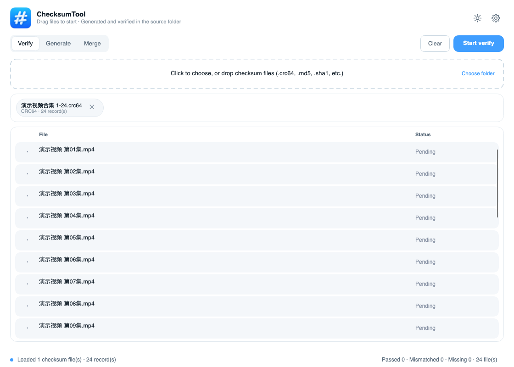
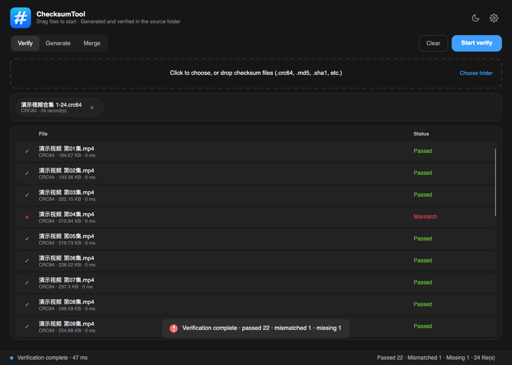
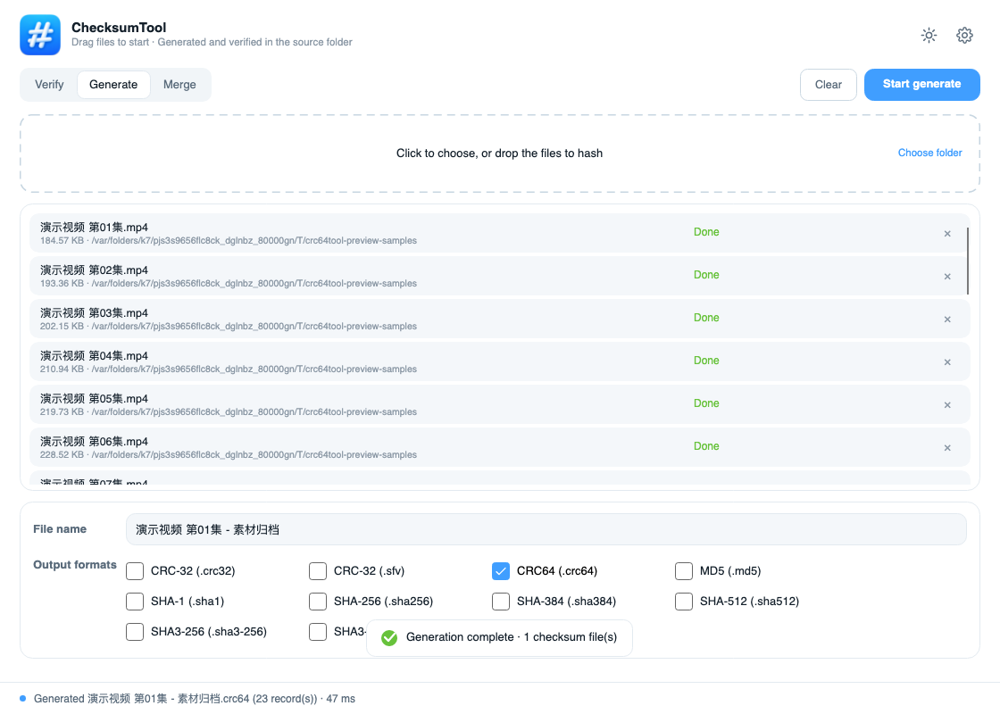
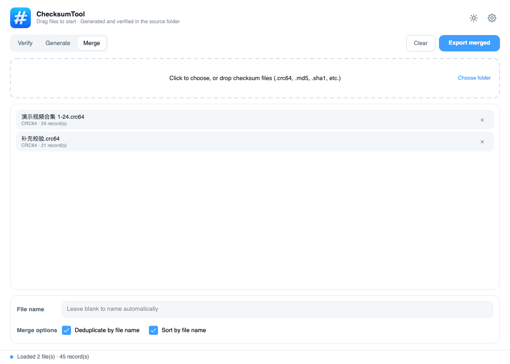
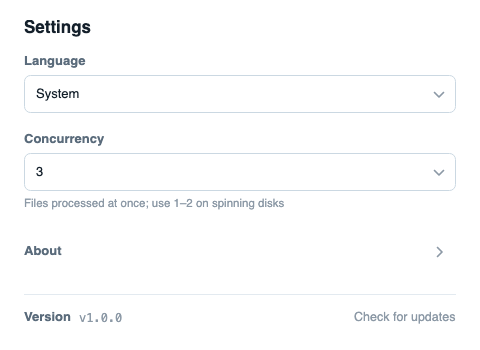
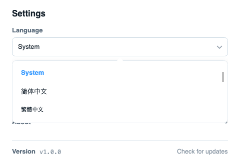
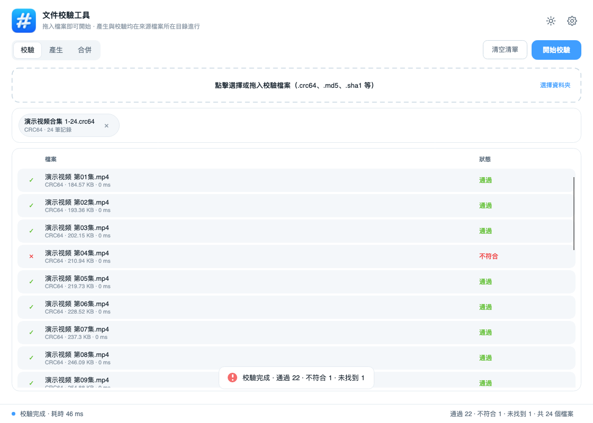
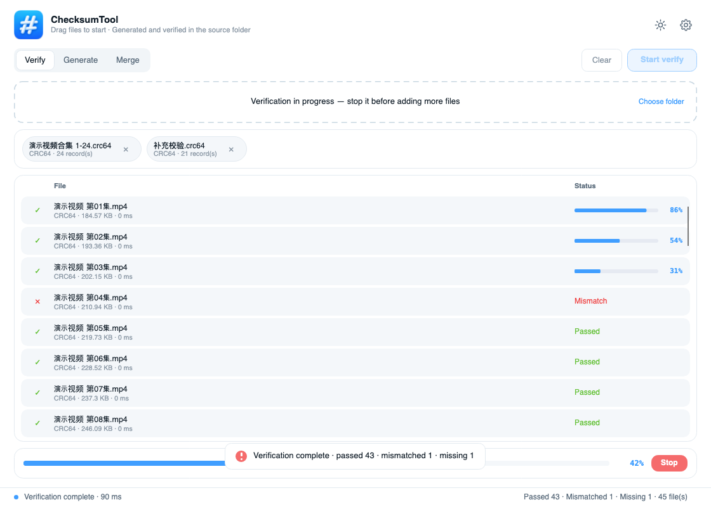

简体中文 | [English](README.en.md) 

# 文件校验工具

一个基于 **.NET 10 + Avalonia UI** 的跨平台桌面工具，用于生成、校验与合并校验文件。
支持 CRC64、MD5、SHA-1、SHA-256、SHA-384、SHA-512、SHA3-256、SHA3-384、SHA3-512 和 CRC-32（含`.crc32` 和 `.sfv`），HashCheck 支持的格式均支持互认。
支持 **Windows / macOS / Linux**，界面现代化，自动跟随系统深浅色，也可一键切换，支持多语言和跟随系统切换已适配语言。

<p align="center">
  
</p>

## 作者声明

本项目代码由 AI 辅助实现。人工仅提供UI产品设计、软件逻辑、设计思路、需求描述与测试反馈。

## 界面预览

| 校验（浅色） | 校验（深色） |
| --- | --- |
|  |  |

| 生成 | 合并 |
| --- | --- |
|  |  |

| 设置 | 下拉选择 |
| --- | --- |
|  |  |

| 多语言（English） | 校验进行中 |
| --- | --- |
|  |  |

> 截图由 `tools/CheckSumTool.Preview` 通过 Avalonia 无头渲染生成，可作为界面回归基线。

---

## 功能

| 面板 | 能力 |
| --- | --- |
| **校验** | 拖入或点选支持的校验文件（`.crc64`、`.md5`、`.sha1`、`.sha256`、`.sha384`、`.sha512`、`.sha3-256`、`.sha3-384`、`.sha3-512`、`.crc32` 或 `.sfv`），自动解析内容并逐条比对关联文件 |
| **生成** | 拖入或点选普通文件，勾选一种或多种输出格式（共 11 项，含 CRC-32 的 `.crc32` 与 `.sfv`），按勾选顺序逐个生成 |
| **合并** | 拖入或点选同算法校验文件，去重 / 排序后整合导出；CRC-32 的 `.crc32` 与 `.sfv` 均识别为同一算法 |

### 关键行为

- **同目录原则**：生成校验文件时写入源文件所在目录；校验时也在校验文件所在目录查找关联文件。
- **两种导入方式**：**点击拖拽区**直接打开系统文件选择器（支持多选）；拖拽区右侧的「选择文件夹」按钮可整目录导入，
  会展开该目录下的文件并**自动跳过以 `.` 开头的隐藏文件**（如 `.DS_Store`、`.gitignore`）以及 `Thumbs.db` / `desktop.ini` 等系统杂物（不弹提示）。
- **并发处理**：可在设置页配置 **1~8 个并发**（默认 3）。并发额度在「格式 × 文件」任务之间共享：只拖入 1 个文件时会同时跑多个算法；拖入多个文件时，排在前面的格式先并行处理各文件，剩余额度继续往后排格式。校验面板同理。
- **忽略有轻提示**：往生成面板拖入任何已识别的校验文件时弹出「已忽略校验文件」，不占用底部状态栏。
- **移除有轻提示**：点击列表里的 × 移除文件时会弹出轻提示，同时状态栏刷新为**当前列表汇总**；列表被清空时状态栏回到默认的「就绪」文案。
- **完成有轻提示**：校验、生成、合并完成后都会在底部弹出一条轻提示（校验全部通过为绿色，存在不匹配 / 未找到时转为红色警告）。
- **停止按钮随任务出现**：开始后，进度条右侧才会出现「停止」按钮，点击终止后按钮自动消失；
  进度条旁只保留百分比，不显示文字说明。
- **可追加**：未开始校验、或已终止校验时，可以继续拖入新的校验文件追加到列表。
- **记录先行展示**：拖入校验文件后立即列出全部记录（含未校验的），校验时逐行更新状态。
- **文件格式互认**：各算法的校验文件使用同一套文本行格式，由扩展名区分算法；CRC-32 的 `.crc32` 与 `.sfv` 使用相同算法。其中 `.sfv` 输出采用 **SFV 原生格式**（文件名居左、按最长文件名补空格对齐、单个空格分隔、小写 8 位 CRC-32），与 Windows 资源管理器扩展 [HashCheck](https://github.com/gurnec/HashCheck) 生成的 `.sfv` 完全互认，`.crc32` 等其他格式仍为统一的 `<校验值> *<文件名>` 行格式。
- **文件夹拖入**：拖入文件夹会展开当前文件夹层级的文件（不含子文件夹）。
- **多语言**：简体中文 / 繁體中文 / English 等，切换即时生效。
- **主题**：右上角圆形按钮可在「跟随系统 → 浅色 → 深色」之间切换。

### 默认文件名规则

**生成面板** —— 文件名随文件列表自动更新；一旦手动改过就不再自动覆盖（清空列表后恢复自动命名）。

| 情况 | 默认文件名 |
| --- | --- |
| 未拖入文件 | 留空（输入框显示「留空则自动命名」提示） |
| 单个文件 `第01集.mp4` | `第01集` |
| 多个文件（`a.mp4` … `z.mp4`） | `a - z`（第一个 - 最后一个） |

**合并面板** —— 输入框默认留空，导出时按 `第一个文件名 - 最后一个文件名` 自动命名
（如 `合集 1-24.crc64` + `补充校验.crc64` → `合集 1-24 - 补充校验.crc64`）。手动填写则以填写的为准。

---

## 下载与安装

从 [Releases](../../releases) 下载对应平台的压缩包，全部为**自包含发布**，无需预装 .NET 运行时。

| 平台 | 架构 | 文件名 |
| --- | --- | --- |
| Windows | x86（32 位） | `checksum-tool-win-x86.zip` |
| Windows | x64 | `checksum-tool-win-x64.zip` |
| Windows | arm64 | `checksum-tool-win-arm64.zip` |
| macOS | Intel (x64) | `checksum-tool-mac-x64.zip` |
| macOS | Apple Silicon (arm64) | `checksum-tool-mac-arm64.zip` |
| Linux | x64 | `checksum-tool-linux-x64.zip` |

### 首次运行

**Windows 文件关联** — 首次启动本程序时，会自动把全部校验文件后缀注册为可关联的扩展名
（`.crc64` / `.md5` / `.sha1` / `.sha256` / `.sha384` / `.sha512` / `.sha3-256` / `.sha3-384` / `.sha3-512` / `.crc32` / `.sfv`，
只写入当前用户的注册表，不需要管理员权限）。注册后：

- 在「默认应用」或「打开方式」里选择「文件校验工具」，即可把这些后缀固定给它；
- **双击任一校验文件**，程序会直接启动、进入校验面板并立即开始校验；
- 也可以命令行调用：`"文件校验工具.exe" --verify "D:\校验文件.crc64"`。

**Windows** — 解压后双击 `文件校验工具.exe`。

**macOS** — 解压得到 `文件校验工具.dmg`，挂载后把 `文件校验工具.app` 拖到「应用程序」。若提示「已损坏」或「无法验证开发者」，可点击 "完成" 后，在 "系统设置"-"隐私与安全性"-"安全性" 中 "点击允许" ，或在 "终端" 应用中执行：

```bash
xattr -dr com.apple.quarantine "/下载目录/文件校验工具.dmg"
```
拖拽 APP 到 Applications (程序坞)，执行
```bash
xattr -dr com.apple.quarantine "/Applications/文件校验工具.app"
```

**Linux** — 需要系统具备 `libX11`、`libICE`、`libSM`、`libfontconfig` 等基础图形库（桌面发行版通常已内置）：

```bash
chmod +x checksum-tool
./checksum-tool
```

---

## 使用说明

### 设置页

点击右上角齿轮按钮打开：

| 设置 | 说明 |
| --- | --- |
| **语言** | 简体中文 / 繁體中文 / English等，切换后界面立即刷新 |
| **同时执行** | 1~8，同时处理的文件数；机械硬盘建议 1~2，SSD/NVMe 建议 3~8 |
| **版本更新** | 检查 GitHub 最新 Release，有新版本则提示并打开下载页，已是最新则提示「当前已是最新版本」 |
| **关于软件** | 打开项目仓库页面 |


设置自动保存，重启后保留。

### 1. 校验校验文件

1. 把支持的校验文件**拖到**虚线框，或**点击**虚线框从系统文件选择器中多选；也可点右侧「选择文件夹」整目录导入。
2. 面板会显示已加载的校验文件标签（含类型与记录条数），**并立即把全部记录列出来**（状态为「等待中」），
   校验前就能确认记录数量与文件名是否符合预期。
3. 点击右上角 **开始校验**。底部进度条显示整体进度，列表逐行刷新状态——正在计算的那一行会在「状态」列显示**该文件自己的进度条**，其余行显示「等待中」或最终结果。
4. 校验过程中，**进度条右侧会出现「停止」按钮**；点击即终止，按钮随之消失。
   已终止时未处理的记录标记为「已取消」，此时可以继续追加新的校验文件。

结果列表逐条展示「文件 / 状态」，把鼠标悬停在文件名上可以看到该条记录的**期望值与实际值**。
统计结果统一显示在**底部状态栏右侧**，随扫描进度实时更新（通过 / 不匹配 / 未找到 / 共 N 个文件）：

| 状态 | 含义 |
| --- | --- |
| · 等待中 | 已列出记录，尚未开始校验 |
| … 校验中 | 正在计算 |
| ✓ 通过 | 计算值与记录值一致 |
| ✕ 不匹配 | 计算值与记录值不同 |
| ? 未找到关联文件 | 校验文件所在目录下找不到记录中的文件（进度条同步提示） |
| ! 读取失败 | 文件被占用或无读取权限 |
| – 已取消 | 校验被终止，该记录未处理 |

### 2. 生成校验文件

1. 把普通文件**拖到**虚线框，或**点击**虚线框多选（已识别的校验文件会被忽略，并弹出提示）。
2. **文件名单独一行**：单文件时取该文件名，多文件时取「第一个 - 最后一个」。
   也可以手动修改，或直接输入扩展名 / 完整路径（输入完整路径时只生成一份）。
3. **文件名下方是输出格式复选项**（共 11 项）：CRC-32 的 `.crc32` 与 `.sfv` 分开列出，其余 9 种算法各一项；
   可**多选**，每个勾选的格式都会为全部输入文件各写出一份校验文件（默认勾选 CRC64）。
4. 点击右上角 **开始生成**。运行中进度条右侧同样会出现「停止」按钮，此时文件名输入框与格式复选项会锁定，避免任务中途改动输出名。

> 输出位置默认跟随源文件目录；如果拖入的文件来自多个目录，会在**每个目录各生成一份**同名校验文件。
> 直接输入绝对路径（如 `/Users/me/out/checksums`）则只生成一份。
> 界面不展示输出路径，把鼠标悬停在文件名输入框上可以看到完整路径。

### 3. 合并校验文件

1. 拖入或点选多个同类型的校验文件。若混入其他不同算法的文件，会弹出警告并禁用导出。
2. 文件名下方是**合并选项**：勾选「按文件名去重」「按文件名排序」（导出过程中会临时禁用）。
3. 导出文件名可留空（自动按「第一个 - 最后一个」命名），也可手动填写；导出过程中输入框会临时锁定。点击右上角 **导出合并文件**。
   导出成功后底部会弹出一条轻提示（约 2.6 秒后自动消失）。

> 成功为绿色对勾，警告为红色感叹号。
> 三种操作都会在完成时给出提示：生成 / 合并为成功提示，校验按结果自动选择成功或警告。

---

## 校验文件格式

一行一条记录：

```
<校验值> *<文件名>
```

- 分隔符为 ` *`（空格 + 星号），也兼容 `<校验值>  <文件名>`（两个空格）。
- 文件名为**纯文件名**（可含子目录相对路径），校验时相对于校验文件所在目录解析。
- 编码 UTF-8（无 BOM），换行 LF。

**CRC64 校验值**固定写成无符号十进制整数，与 `crc64ecma.cs` 的输出一致：

```
6967259512934720053 *video.mp4
```

> 读取时额外兼容 16 位十六进制与 `0x` 前缀写法，方便校验其它工具产出的文件；但**写入永远是十进制**。

**MD5 校验值**为 32 位十六进制：

```
900150983cd24fb0d6963f7d28e17f72 *file.bin
```

### CRC64 算法

| 参数 | 值 |
| --- | --- |
| Polynomial | `0xC96C5795D7870F42`（反射） |
| Init | `0xFFFFFFFFFFFFFFFF` |
| RefIn / RefOut | `true` / `true` |
| XorOut | `0xFFFFFFFFFFFFFFFF` |
| 校验值（`"123456789"`） | `0x995DC9BBDF1939FA` = `11051210869376104954` |

### 其他算法参数

下表的「校验值」列均指对标准测试数据 `"123456789"` 的运算结果，可用于核对本工具与其它工具是否一致。

| 算法 | 输出扩展名 | 校验值形式 | `"123456789"` 校验值 |
| --- | --- | --- | --- |
| CRC-32 | `.crc32` / `.sfv` | 8 位小写十六进制 | `cbf43926` |
| MD5 | `.md5` | 32 位小写十六进制 | `25f9e794323b453885f5181f1b624d0b` |
| SHA-1 | `.sha1` | 40 位小写十六进制 | `f7c3bc1d808e04732adf679965ccc34ca7ae3441` |
| SHA-256 | `.sha256` | 64 位小写十六进制 | `15e2b0d3c33891ebb0f1ef609ec419420c20e320ce94c65fbc8c3312448eb225` |
| SHA-384 | `.sha384` | 96 位小写十六进制 | `eb455d56d2c1a69de64e832011f3393d45f3fa31d6842f21af92d2fe469c499da5e3179847334a18479c8d1dedea1be3` |
| SHA-512 | `.sha512` | 128 位小写十六进制 | `d9e6762dd1c8eaf6d61b3c6192fc408d4d6d5f1176d0c29169bc24e71c3f274ad27fcd5811b313d681f7e55ec02d73d499c95455b6b5bb503acf574fba8ffe85` |
| SHA3-256 | `.sha3-256` | 64 位小写十六进制 | `87cd084d190e436f147322b90e7384f6a8e0676c99d21ef519ea718e51d45f9c` |
| SHA3-384 | `.sha3-384` | 96 位小写十六进制 | `8b90ede4d095409f1a12492c2520599683a9478dc70b7566d23b3e41ece8538c6cde92382a5e38786490375c54672abf` |
| SHA3-512 | `.sha3-512` | 128 位小写十六进制 | `e1e44d20556e97a180b6dd3ed7ae5c465cafd553fa8747dca038fb95635b77a37318f7ddf7aec1f6c3c14bb160ba2497007decf38dd361cab199e3b8c8fe1f5c` |

**CRC-32（IEEE 802.3）算法参数**——与 PKZip / WinRAR / HashCheck 所生成的 SFV 完全一致：

| 参数 | 值 |
| --- | --- |
| Polynomial | `0x04C11DB7`（位反序等价形式 `0xEDB88320`） |
| Init | `0xFFFFFFFF` |
| RefIn / RefOut | `true` / `true` |
| XorOut | `0xFFFFFFFF` |
| 校验值（`"123456789"`） | `0xCBF43926` = `3421780262` |

**SHA 家族**（MD5 见 RFC 1321；SHA-1 / SHA-2 见 FIPS 180-4；SHA-3 见 FIPS 202）均为逐块流式计算，输出为定长十六进制字符串，写入校验文件时一律小写；读取时兼容大写与 `0x` 前缀。

各算法校验文件示例（同一文件 `video.mp4`）：

```
cbf43926 *video.mp4                                        # .crc32（十进制）
25f9e794323b453885f5181f1b624d0b *video.mp4                # .md5
f7c3bc1d808e04732adf679965ccc34ca7ae3441 *video.mp4        # .sha1
15e2b0d3c33891ebb0f1ef609ec419420c20e320ce94c65fbc8c3312448eb225 *video.mp4                              # .sha256
eb455d56d2c1a69de64e832011f3393d45f3fa31d6842f21af92d2fe469c499da5e3179847334a18479c8d1dedea1be3 *video.mp4   # .sha384
d9e6762dd1c8eaf6d61b3c6192fc408d4d6d5f1176d0c29169bc24e71c3f274ad27fcd5811b313d681f7e55ec02d73d499c95455b6b5bb503acf574fba8ffe85 *video.mp4                            # .sha512
87cd084d190e436f147322b90e7384f6a8e0676c99d21ef519ea718e51d45f9c *video.mp4                                # .sha3-256
8b90ede4d095409f1a12492c2520599683a9478dc70b7566d23b3e41ece8538c6cde92382a5e38786490375c54672abf *video.mp4   # .sha3-384
e1e44d20556e97a180b6dd3ed7ae5c465cafd553fa8747dca038fb95635b77a37318f7ddf7aec1f6c3c14bb160ba2497007decf38dd361cab199e3b8c8fe1f5c *video.mp4                            # .sha3-512
```

> 说明：CRC-32 的 `.sfv` 不使用上面的统一行格式，而是采用 SFV 原生格式（见「文件格式互认」条目）；上例仅针对 `.crc32`。

**算法如何选择**：

| 场景 | 推荐 |
| --- | --- |
| 与 CRC64 工具链互通、日常快速校验 | CRC64 |
| 与 Windows HashCheck / 老工具互通 | CRC-32（`.sfv`） |
| 通用完整性校验，兼顾速度与碰撞率 | SHA-256 |
| 强完整性校验（下载、归档） | SHA-512 / SHA3-512 |
| 仅排除传输误码、不在意安全性 | MD5 / CRC 系列 |

> 安全提示：MD5、SHA-1、CRC 系列**不抗恶意篡改**，仅用于检测传输误码或文件版本比对；有安全需求时请使用 SHA-256 及以上。

---

## 本地开发

需要 [.NET 10 SDK](https://dotnet.microsoft.com/download/dotnet/10.0)。

```bash
# 运行（务必用 Release：Debug 下 SHA3 会慢约 5 倍）
dotnet run --project src/CheckSumTool -c Release

# 运行单元测试
dotnet test tests/CheckSumTool.Tests

# 本地发布（示例：Apple Silicon macOS）
dotnet publish src/CheckSumTool -c Release -r osx-arm64 --self-contained true \
  -p:PublishSingleFile=true -p:IncludeNativeLibrariesForSelfExtract=true -o publish/osx-arm64
```

> **性能提示**：SHA-1 / SHA-256 / SHA-384 / SHA-512 / MD5 走系统原生实现（硬件加速，通常 >1 GB/s）。
> SHA3-256 / SHA3-384 / SHA3-512 在 macOS 上只能走纯托管 Keccak-f（系统与 .NET 均不提供原生 SHA3），
> 实测 Release 下约 130~260 MiB/s。**Debug 配置不会优化热循环，SHA3 会再慢约 5 倍**
> （400 MB 文件从约 2 秒变成约 10 秒），因此日常使用请始终用 `-c Release` 或发布版。

重新生成 Windows 可执行文件图标（从 `icon/logo.png` 生成多尺寸 ICO，需要 macOS 的 `sips`）：

```bash
python3 tools/make_ico.py
```

> 图标资源统一放在 `icon/`：`logo.png` 供 Windows / Linux 使用，`logo.icns` 供 macOS 使用；
> 构建时会把它们打包进 `src/CheckSumTool/Assets/`（其中 `logo.ico` 由脚本生成）。

重新生成文档截图（Avalonia 无头渲染，跨平台可用）：

```bash
dotnet run --project tools/CheckSumTool.Preview -- docs/screenshots
```

### 项目结构

```
.
├── .github/workflows/build.yml        # CI：跨平台构建 + 自动发布 Release
├── src/CheckSumTool/
│   ├── Core/                          # 算法与校验文件读写（与 UI 解耦）
│   │   ├── Crc64.cs                   # CRC64-ECMA（与 crc64ecma.cs 等价），slicing-by-8
│   │   ├── HashEngine.cs              # 流式 CRC64 / MD5，进度 + 取消
│   │   ├── ChecksumFile.cs            # .crc64 / .md5 解析与序列化
│   │   └── HashKind.cs
│   ├── Localization/                  # 三语言文案表与访问器
│   ├── Controls/SelectBox.axaml       # Element 风格下拉选择器
│   ├── Helpers/                       # 拖拽、系统文件选择器
│   ├── Services/SettingsService.cs    # 偏好设置持久化
│   ├── Services/FileAssociation.cs   # Windows 文件关联（.crc64 / .md5）
│   ├── Services/CommandLine.cs       # 命令行解析（--verify / 双击文件）
│   ├── ViewModels/                    # MVVM 视图模型
│   ├── Views/                         # Avalonia 界面（含 SettingsWindow）
│   └── Styles/Controls.axaml          # 主题与控件样式
├── tests/CheckSumTool.Tests/             # xUnit 单元测试
├── icon/                              # 应用图标源文件（logo.png / logo.icns）
├── tools/
│   ├── CheckSumTool.Preview/             # 无头渲染截图工具（不参与发布）
│   └── make_ico.py                    # 由 logo.png 生成多尺寸 ICO
└── docs/screenshots/                  # 文档截图
```

---

## 发布流程

**自动发布（默认）** —— 每次推送到 `main` / `master` 分支，都会自动完成「单元测试 → 六平台构建 → 发布 Release」
全流程，无需任何额外操作。Release 的 tag 为 `v` + UTC 时间戳（如 `v202610150511`，与安装包内显示的版本号一致），
并自动标记为仓库的 Latest Release。

**发布指定版本号** —— 推一个 `v*` 形式的 tag，即可以该 tag 发布：

```bash
git tag v1.0.0
git push origin v1.0.0
```

也可以在 Actions 页面手动触发 `Build & Release`，在 `tag` 输入框填写版本号（如 `v1.0.0`）以创建 Release；留空则只构建产物。

> Pull Request 只运行测试与构建，不会发布 Release。

工作流步骤：

1. `unit tests` — 在 Ubuntu 上运行 xUnit 测试（CRC64 标准校验值、格式解析、取消逻辑、默认命名、多语言完整性等）。
2. `build` — 六个 RID 并行 `dotnet publish`，macOS 额外组装 `.app` 包并做 ad-hoc 签名。
3. `release` — 汇总各平台 zip，创建 GitHub Release 并上传产物。

---

## 常见问题

**Q：为什么 macOS 上双击提示「已损坏」？**
未做 Apple 开发者签名与公证。执行 `xattr -dr com.apple.quarantine 文件校验工具.app` 即可。

**Q：Linux 上启动报缺少 `libX11` / `libSkiaSharp`？**
安装基础图形库，例如 Debian/Ubuntu：`sudo apt install libx11-6 libice6 libsm6 libfontconfig1`。

**Q：校验时提示「未找到关联文件」？**
校验文件里记录的是纯文件名，工具会在**校验文件所在目录**查找。请确保目标文件与校验文件在同一目录。

**Q：设置保存在哪里？**
`%APPDATA%\CheckSumTool\settings.json`（Windows）、`~/Library/Application Support/CheckSumTool/settings.json`（macOS）、`~/.config/CheckSumTool/settings.json`（Linux），
保存主题模式、语言、并发数与合并选项。位置与浏览器的 LocalStorage 等价，界面中不展示。
开发/测试时可用环境变量 `CHECKSUMTOOL_SETTINGS_DIR` 重定向该目录。

---

## 许可证

MIT
